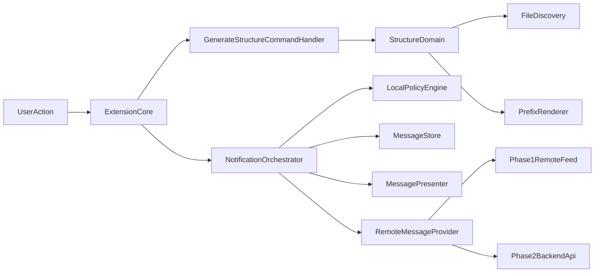

# Arquitectura V2

## Objetivo

Definir una arquitectura extensible para `draw-folder-structure` que permita incorporar funcionalidades remotas (notificaciones y monetización) sin acoplarlas al flujo core de generación de estructura Markdown.

## Estado actual (baseline)

- El entrypoint está en `src/extension.ts`.
- El comando principal (`extension.generateMarkdownStructure`) concentra lectura de configuración, lógica de ejecución, UX y telemetría.
- La lógica de dominio actual está repartida entre:
  - `src/functions/generate-structure.ts`
  - `src/functions/find-files.ts`
  - `src/functions/get-prefix.ts`
- Existe una implementación de telemetría en `src/functions/telemetry-service.ts` que queda fuera del alcance objetivo de V2.

## Principios de diseño V2

1. **Core aislado**: generar estructura Markdown debe funcionar sin red ni servicios externos.
2. **Capacidades opcionales**: notificaciones remotas se montan sobre módulos independientes.
3. **Fail-open**: cualquier error remoto no puede degradar el comando principal.
4. **Evolución por fases**: primera fase simple y validable; segunda fase con backend más robusto.
5. **Sin telemetría**: no instrumentar uso/errores con proveedores externos.

## Arquitectura objetivo

## Límites de módulos recomendados

### Core de extensión

- `src/extension.ts`
  - Bootstrap de módulos.
  - Registro de comandos.
  - Activación de capacidades opcionales.

### Dominio de generación

- `src/core/structure/`
  - `StructureService`: orquesta generación de árbol.
  - `FileDiscoveryPort`: contrato para descubrir archivos/carpetas.
  - `PrefixRendererPort`: contrato para estilos de salida.

### Notificaciones remotas

- `src/features/notifications/`
  - `NotificationOrchestrator`: ejecuta fetch, filtro y presentación.
  - `RemoteMessageProvider`: obtiene mensajes remotos.
  - `LocalPolicyEngine`: aplica reglas de frecuencia/elegibilidad.
  - `MessageStore`: persistencia local (estado de dismiss/snooze/seen).
  - `MessagePresenter`: integración con UI de VS Code.

### Configuración

- `src/config/`
  - lectura tipada de settings de VS Code.
  - validación de defaults para features opcionales.

## Flujo de activación V2 (alto nivel)

1. Activar extensión y registrar comando principal.
2. Inicializar `StructureService` para el core.
3. Inicializar `NotificationOrchestrator` (si `remoteNotifications.enabled`).
4. Ejecutar comando de estructura sin depender de red.
5. En paralelo no bloqueante, evaluar y presentar notificaciones elegibles.

## Decisiones arquitectónicas (ADR livianas)

- **ADR-001**: Enfoque híbrido progresivo para entrega incremental.
- **ADR-002**: Monetización inicial por donaciones.
- **ADR-003**: Notificaciones bajo política fail-open.
- **ADR-004**: Separar orquestación remota del comando principal.
- **ADR-005**: Remover telemetría y dependencias asociadas.

## Trade-offs

- Menor velocidad inicial al separar capas, a cambio de mantenibilidad.
- Más contratos internos (ports/adapters), a cambio de testabilidad.
- Menos observabilidad técnica al quitar telemetría, a cambio de simplicidad y privacidad.

## Qué sigue

- Definir contrato remoto de notificaciones en `docs/v2/remote-notifications.md`.
- Definir estrategia de monetización en `docs/v2/monetization-donations.md`.
- Preparar checklist de retiro total de telemetría en `docs/v2/deprecations.md`.
